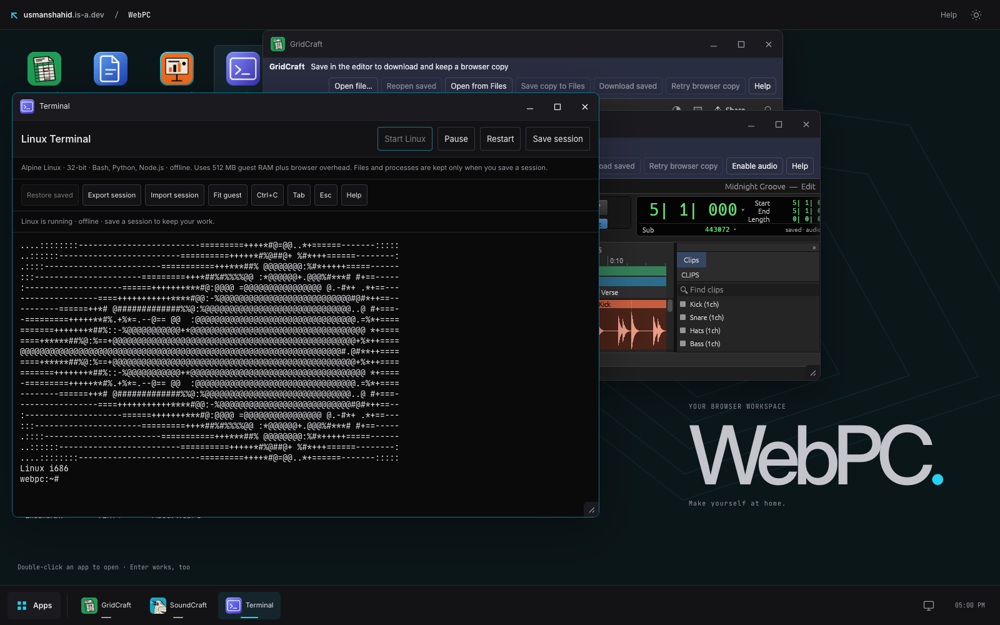
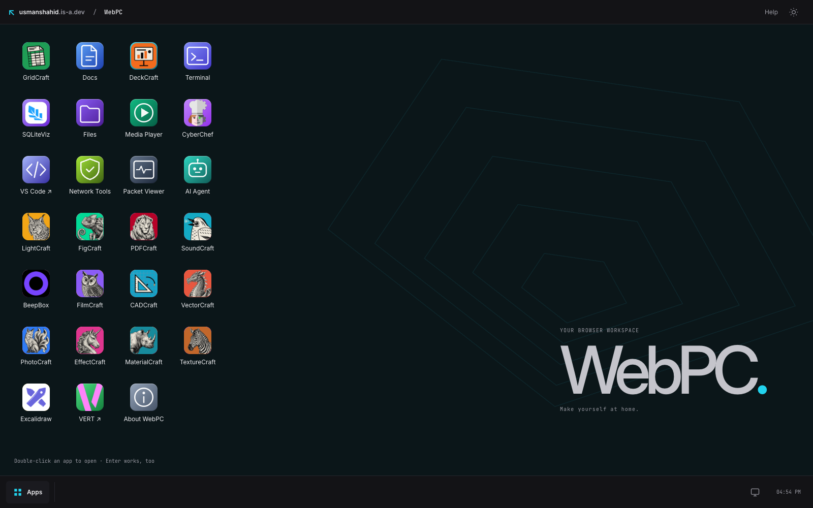
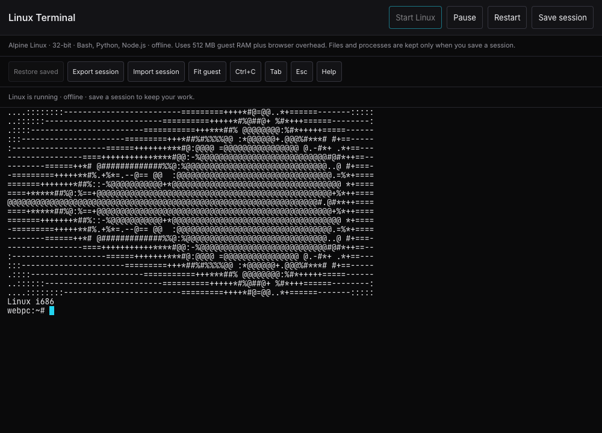
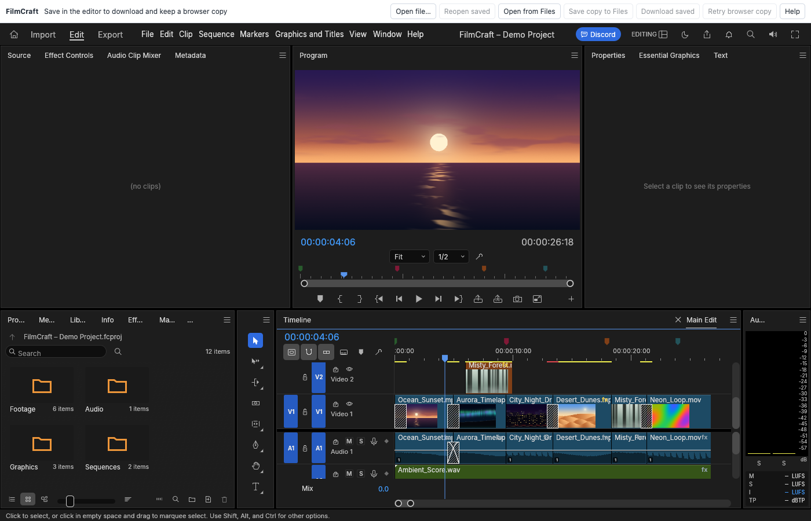
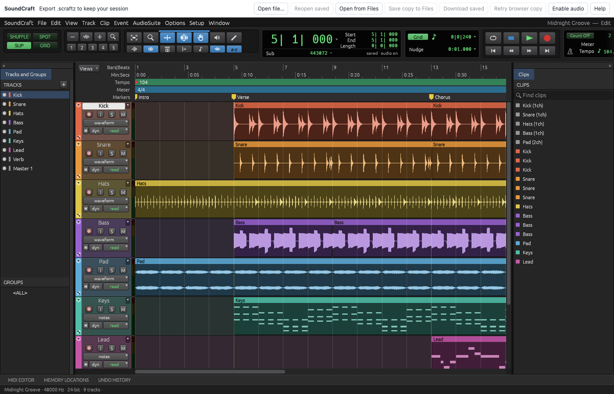
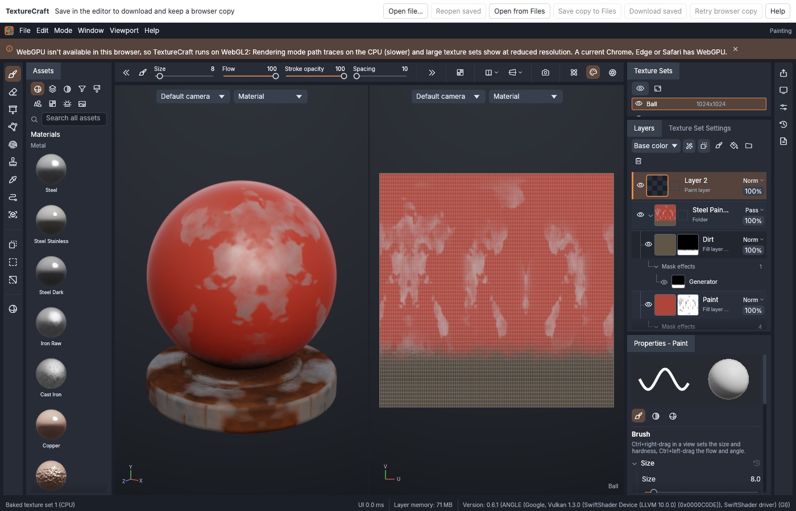
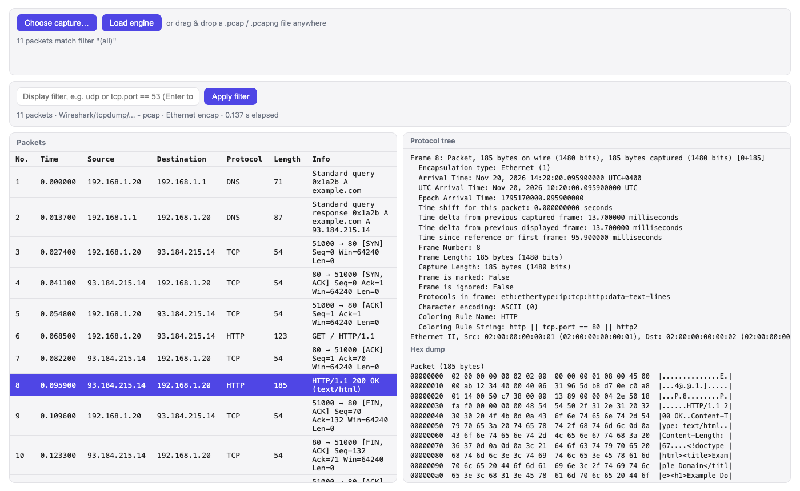
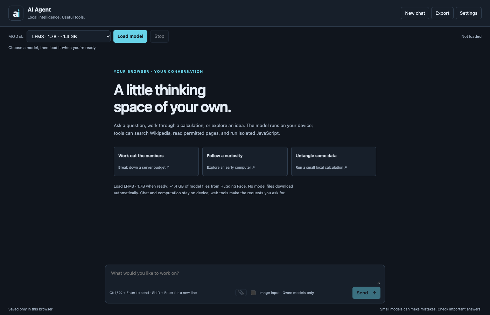
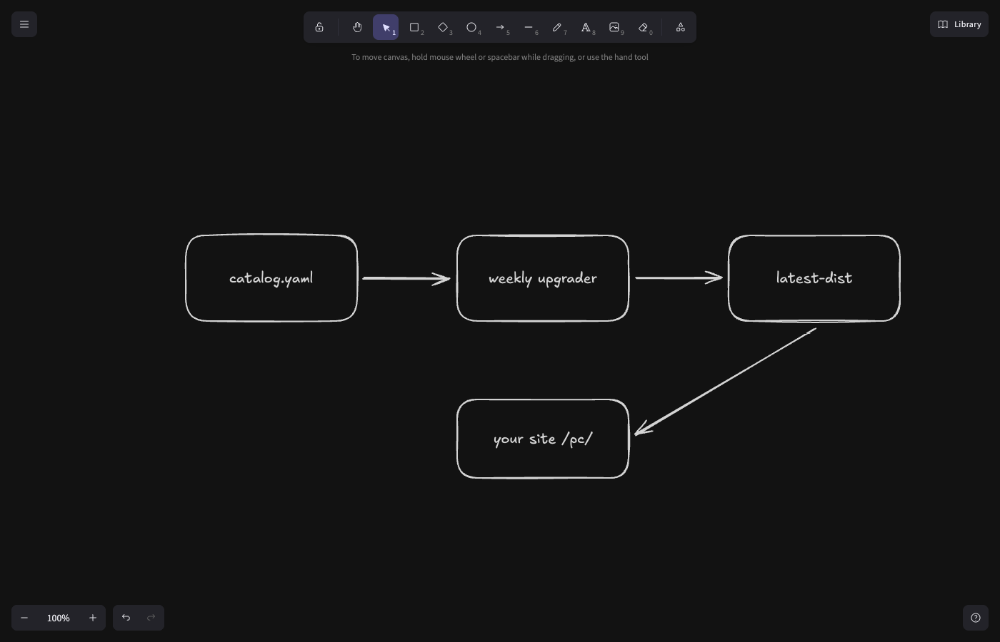
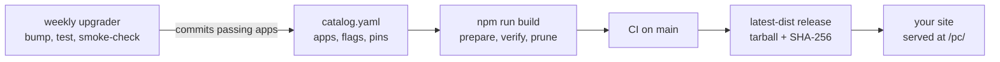

<p align="center">
  <a href="https://usmanshahid.is-a.dev/pc/"></a>
</p>

<h1 align="center">WebPC</h1>

<p align="center">
  <b>A whole desktop in a browser tab.</b><br>
  24 real apps (a video editor, a 3D texture painter, a music DAW, Linux, Wireshark and an AI agent) running entirely on your machine.<br>
  Pinned, verified and kept up to date by a weekly robot.
</p>

<p align="center">
  <a href="https://usmanshahid.is-a.dev/pc/"><b>▶&nbsp;Try it live at usmanshahid.is-a.dev/pc</b></a>
</p>

<p align="center">
  <a href="https://github.com/codemug/webpc/actions/workflows/ci.yml"></a>
  <a href="https://github.com/codemug/webpc/actions/workflows/upgrade.yml"></a>
  <a href="https://github.com/codemug/webpc/releases/tag/latest-dist"></a>
</p>

---

## Why WebPC

- **Real apps, not mock-ups.** The Storytold Craft editors are full Rust and WebAssembly applications. The Terminal boots Alpine Linux in an x86 emulator. The Packet Viewer runs Wireshark's own dissectors. The AI Agent runs language models on your GPU.
- **Nothing leaves your machine.** Opening an app makes zero requests to any other host. The smoke checks and browser tests assert this for each app. Your files stay in your browser's storage, and network tools only reach out when you press their button.
- **No server.** WebPC is a static site: drop the build into any host and serve it at `/pc/`.
- **Pinned and verified.** Every upstream release is pinned to an exact version and SHA-256 checksum, and checked before it is unpacked.
- **Keeps itself current.** Every Monday a workflow looks for new releases, upgrades each app, and runs the unit tests, a full build and a headless smoke check. Only then does it commit to `main`. Anything that needs a person lands in [one tidy issue](https://github.com/codemug/webpc/issues).
- **One file to rule it.** [`catalog.yaml`](catalog.yaml) lists every app and every pin. Set `enabled: false` and the app is gone from the desktop and the build.

## A look inside

<table>
  <tr>
    <td width="50%"><br><b>The desktop.</b> Windows, a taskbar, an app launcher, keyboard control, and light and dark themes.</td>
    <td width="50%"><br><b>Terminal.</b> Real 32-bit Alpine Linux with Bash, Python and Node.js. It runs offline, and you can save and restore whole sessions.</td>
  </tr>
  <tr>
    <td><br><b>FilmCraft.</b> A timeline video editor with effects, titles and audio mixing.</td>
    <td><br><b>SoundCraft.</b> A multitrack audio workstation for editing, mixing and exporting.</td>
  </tr>
  <tr>
    <td><br><b>TextureCraft.</b> Paint and bake PBR textures onto 3D meshes.</td>
    <td><br><b>Packet Viewer.</b> Open pcap and pcapng captures with Wireshark 4.6 dissectors, compiled to WebAssembly.</td>
  </tr>
  <tr>
    <td><br><b>AI Agent.</b> On-device models with tools for files, the web, OCR, background removal and running code in the Terminal. An optional cloud model uses your own key.</td>
    <td><br><b>Excalidraw.</b> Hand-drawn diagrams with its fonts served by WebPC, never fetched from a CDN. Pictured: how WebPC ships.</td>
  </tr>
</table>

## What's on the desktop

| | Apps |
|---|---|
| **Office** | GridCraft (spreadsheets) · Docs · DeckCraft (presentations) · PDFCraft |
| **Creative** | FilmCraft · EffectCraft · SoundCraft · BeepBox · PhotoCraft · LightCraft · VectorCraft · FigCraft · CADCraft · MaterialCraft · TextureCraft · Excalidraw |
| **Developer** | Terminal (Alpine Linux) · Packet Viewer (Wireshark dissectors) · VS Code (opens vscode.dev) |
| **Utilities** | AI Agent · Files · Media Player · SQLiteViz · CyberChef · Network Tools (DNS, RDAP, global ping, subnets, password strength, age encryption) · VERT (opens vert.sh) |

## How it ships



1. **[`catalog.yaml`](catalog.yaml)** holds each app's desktop entry, its `enabled` flag and its pinned sources. There are 39 sources, 29 of them on automatic upgrades.
2. **`npm run build`** does the following:
   - validates the catalog;
   - downloads and verifies each enabled app;
   - builds the static site;
   - removes the pages and files of disabled apps;
   - fails if the result exceeds 990 MB (GitHub Pages allows 1 GB).
3. **CI** runs the tests and the build on every push. On `main` it publishes the result as the [`latest-dist`](https://github.com/codemug/webpc/releases/tag/latest-dist) release.
4. **A host site** downloads `latest-dist`, checks the checksum and serves it at `/pc/`. [codemug.github.io](https://github.com/codemug/codemug.github.io) does this on every deploy and once a day.

## The catalog

Each entry under `apps:` has a desktop entry (`title`, `category`, `keywords`, `description`, `src`, `kind`, window size), an `enabled` flag, an optional upstream `icon`, and its `sources`:

```yaml
- id: gridcraft
  enabled: true
  title: GridCraft
  category: Office
  icon:                     # the app's own icon, pinned and served by WebPC
    from: repo              # a file in the app's repo at its release tag
    path: assets/app-icon/hicolor/256x256/apps/ai.storyteller.gridcraft.png
    sha256: 3d8cb180ae9ea3691051e8d2309e79baf6f69e0a86276bf50265b5867ff26e41
  sources:
    - type: github-release
      repo: storytold/gridcraft
      tag: v0.19.1
      asset: gridcraft-web-*.zip
      url: https://github.com/storytold/gridcraft/releases/download/v0.19.1/gridcraft-web-0.19.1.zip
      sha256: 48c5d1b101befebb3c5ba3b7a14914f01c3207934813ed07dc4251b7ae116a78
      upgrade: auto
```

| Source type | Pinned by | Used for |
|---|---|---|
| `github-release` | tag, asset URL and SHA-256 (plus an optional pinned licence file) | the Craft apps, SQLiteViz, BeepBox, CyberChef |
| `npm` | exact version, matching `package.json` and the lockfile | xterm, Excalidraw, the Network Tools libraries |
| `npm-tarball` | version and SRI integrity | wiregasm (Packet Viewer) |
| `cdn-file` | package, version, file and SHA-256 | Transformers.js, Readability |
| `alpine` | the Linux guest's package lock | Terminal |
| `huggingface` | model repo and commit | AI Agent models |

Icons come from upstream wherever the app ships one: the Storytold apps' own icon set (re-pinned by the upgrader whenever the tag moves), the icons inside the SQLiteViz, BeepBox and CyberChef releases, and pinned files for Excalidraw and VERT. WebPC's own apps keep its gradient tiles.

`npm run catalog` validates the file, naming the app and field of every defect, and generates the desktop registry. `npm test` and `npm run build` run it first.

## Automatic upgrades

[`upgrade.yml`](.github/workflows/upgrade.yml) runs every Monday at 03:00 UTC, or on demand for a single app. For each `upgrade: auto` source it picks the newest eligible release:

- **GitHub releases:** only from the pinned repo, never a draft, a prerelease or a downgrade.
- **npm packages:** within the pinned major version (for `0.x`, within the minor).
- **The Linux guest:** whatever Alpine's index currently ships.

Every release must be at least 3 days old. One app at a time, the upgrader writes the new pins (hashing the exact new files), then runs the tests, the build and that app's smoke check. A pass becomes one commit on `main`; a failure is reverted and reported. Manual sources (hand-written adapters, AI model revisions) and new major versions are listed in the issue instead.

```sh
npm run upgrade -- --dry-run   # see what is newer upstream, change nothing
```

## Run it yourself

```sh
npm ci --ignore-scripts
npm test               # unit tests (validates the catalog first)
npm run build          # needs Docker, Python 3 and unzip for a clean build
npm run preview        # open http://localhost:4321/pc/
npm run test:browser   # Playwright suite against the build (Chromium)
```

A clean build caches the pinned downloads in `node_modules/.cache/webpc/`.

To host WebPC on your own static site, download `webpc-dist.tar.gz` from [`latest-dist`](https://github.com/codemug/webpc/releases/tag/latest-dist) and verify it against `webpc-dist.tar.gz.sha256`. Then extract it into your build output. It contains `pc/` and `third-party/`.

## Credits

WebPC stands on excellent open-source work, including:
- the [Storytold](https://github.com/storytold) Craft apps;
- [v86](https://github.com/copy/v86) and [Alpine Linux](https://alpinelinux.org/);
- [wiregasm](https://github.com/good-tools/wiregasm) and Wireshark;
- [Transformers.js](https://github.com/huggingface/transformers.js);
- [Excalidraw](https://github.com/excalidraw/excalidraw), [CyberChef](https://github.com/gchq/CyberChef), [SQLiteViz](https://github.com/lana-k/sqliteviz), [BeepBox](https://github.com/johnnesky/beepbox) and [xterm.js](https://github.com/xtermjs/xterm.js).

Each app's licence, notices and the changes WebPC made are under [`public/third-party/`](public/third-party/), served at `/third-party/`. Integration notes live in [`docs/webpc/`](docs/webpc/), and the window manager design is in [`src/components/pc/DESIGN.md`](src/components/pc/DESIGN.md).

<p align="center"><a href="https://usmanshahid.is-a.dev/pc/"><b>Open WebPC</b></a> · made by <a href="https://usmanshahid.is-a.dev">Usman Shahid</a></p>
